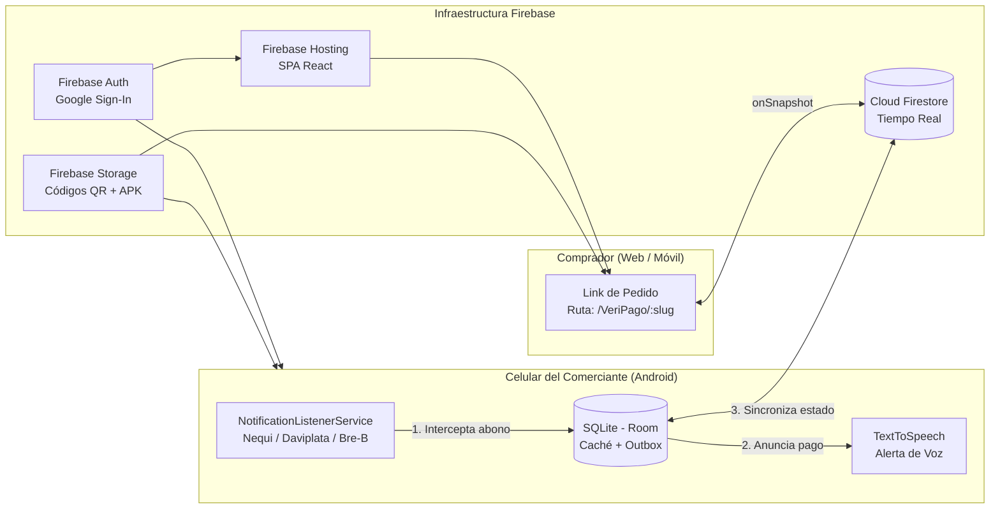

# VeriPago 🧾🔊

**VeriPago** es un ecosistema **Web + Móvil (Android)** de gestión de pedidos y conciliación automática de transferencias por código QR (**Bre-B, Nequi y Daviplata**) con **0 % de comisiones**. 

Conecta los pedidos configurados por el comercio con las notificaciones reales de abono recibidas en su teléfono Android, validando el pago al instante, emitiendo una **confirmación en voz alta** (estilo datáfono) y conservando la trazabilidad completa para realizar entregas *in situ* sin depender de comprobantes enviados por chat.

> **Nota de alcance:** VeriPago no actúa como intermediario financiero ni retiene fondos. El dinero viaja directamente de la cuenta del comprador a la llave Bre-B, Nequi o Daviplata del comercio; la plataforma automatiza la liquidación, verificación y trazabilidad del pedido.

---

## ✨ Características Principales

* **Doble Modalidad de Cobro Coexistente:**
  * **Mostrar QR en pantalla (*In Situ*):** Ideal para mostrador o punto de entrega. Muestra el resumen del pedido liquidado junto con el QR del comercio para cobrar de inmediato sin demoras ni desistimientos de compra.
  * **Compartir link vía WhatsApp:** Genera una ruta corta (`https://lantonium.com/VeriPago/{slug}`) donde el cliente liquida su pedido, registra sus datos de fidelización y visualiza en tiempo real cuando su transferencia es aprobada.
* **Confirmación Auditiva en Tiempo Real (TTS):** Al detectar la notificación bancaria en el teléfono del comercio, la app móvil anuncia en voz alta el monto recibido y el nombre del pedido (ej. *"VeriPago: recibiste quince mil pesos, pedido de Familia Pérez"*).
* **Arquitectura Offline-First (SQLite + Firestore):** La app Android almacena localmente los pedidos en **SQLite (Room)** para validar pagos y emitir alertas de voz incluso ante fallas temporales de señal, sincronizando automáticamente con **Cloud Firestore** al recuperar conexión.
* **Sistema Unificado por Perfiles:** Una única aplicación Web y una única aplicación Android que adaptan su interfaz dinámicamente tras iniciar sesión con **"Continuar con Google"**:
  * **Comerciante:** Configurador de pedidos/formularios, cobro QR dual, tablero de trazabilidad, entregas *in situ* y monitor de dispositivo receptor.
  * **Usuario:** Historial de pedidos pagados, comprobantes digitales verificados y puntos de fidelización.
  * **Administrador:** Dashboard global, gestor dinámico de expresiones regulares (Regex) para lectura bancaria, gestión de usuarios, banners/eventos, auditoría inmutable y publicación de nuevas versiones `.apk`.

---

## 🏗️ Arquitectura del Sistema


---

## 🛠️ Stack Tecnológico

| Capa | Tecnología | Propósito |
| :--- | :--- | :--- |
| **Frontend Web** | React, TypeScript, Vite, Tailwind CSS | SPA responsiva alojada bajo `/VeriPago/` con cálculo reactivo (`expr-eval`). |
| **App Móvil** | Kotlin, Jetpack Compose, Material 3 | App nativa Android (API 26+) con escucha en segundo plano y voz nativa. |
| **BD Nube** | Cloud Firestore | Persistencia central, reglas de seguridad por perfil y eventos en tiempo real. |
| **BD Móvil** | SQLite (Room) + WorkManager | Operación autónoma sin conexión, idempotencia por hash SHA-256 y cola de sincronización. |
| **Autenticación** | Firebase Authentication | Acceso unificado exclusivo mediante proveedor **Google**. |
| **Hosting & Archivos** | Firebase Hosting + Cloud Storage | Despliegue en `https://lantonium.com/VeriPago/`, almacenamiento de QRs y distribución directa del `.apk`. |

---

## 📂 Estructura del Repositorio

```text
veripago/
├── web/                        # Aplicación Web SPA (React + TypeScript + Vite)
│   ├── src/
│   │   ├── components/         # Componentes UI y modales QR in situ
│   │   ├── pages/              # Vistas por perfil (/comercio, /mi-cuenta, /admin, /:slug)
│   │   ├── services/           # Conexión Firestore, Auth Google y Storage
│   │   └── utils/              # Evaluador seguro de fórmulas y exportadores Excel/CSV
│   └── vite.config.ts          # Configurado con base: '/VeriPago/'
├── android/                    # Aplicación Móvil Nativa (Kotlin + Jetpack Compose)
│   └── app/src/main/
│       ├── java/.../data/      # Entidades Room (SQLite), DAOs y SyncManager con Firestore
│       ├── java/.../service/   # PaymentNotificationListenerService y ForegroundService
│       ├── java/.../tts/       # Motor de confirmación auditiva (TextToSpeech)
│       └── java/.../ui/        # Pantallas Compose por rol (Comerciante, Usuario, Admin)
├── firebase/                   # Configuración de infraestructura
│   ├── firestore.rules         # Seguridad estricta por roles y protección de audit_logs
│   ├── firestore.indexes.json  # Índices compuestos para conciliación y reportes
│   └── storage.rules           # Permisos para imágenes QR y descarga pública del .apk
└── firebase.json               # Reglas de Hosting y rewrites para /VeriPago/**
```

---

## 🚀 Instalación y Desarrollo Local

### 1. Requisitos Previos
* **Web:** Node.js 20+ y Firebase CLI (`npm install -g firebase-tools`).
* **Android (flujo ligero sin Android Studio):** JDK 17 o 21, Android Command Line Tools (`sdkmanager` con `platform-tools`, `platforms;android-35`, `build-tools;35.0.0`) y `adb`.

### 2. Configuración de Variables de Entorno (`web/.env`)
```env
VITE_FIREBASE_API_KEY=tu_api_key
VITE_FIREBASE_AUTH_DOMAIN=tu_proyecto.firebaseapp.com
VITE_FIREBASE_PROJECT_ID=tu_proyecto_id
VITE_FIREBASE_STORAGE_BUCKET=tu_proyecto.appspot.com
VITE_FIREBASE_MESSAGING_SENDER_ID=tu_sender_id
VITE_FIREBASE_APP_ID=tu_app_id
```

### 3. Ejecutar la Aplicación Web
```bash
cd web
npm install
npm run dev
```
La aplicación estará disponible localmente en `http://localhost:5173/VeriPago/`.

### 4. Compilar, Instalar y Depurar la App Android por CLI (Sin Android Studio)
Conecta tu teléfono Android con **Depuración USB** activada y ejecuta:

```bash
cd android

# 1. Compilar APK en modo debug
./gradlew assembleDebug

# 2. Instalar en el dispositivo físico
adb install -r -t app/build/outputs/apk/debug/app-debug.apk

# 3. Conceder permiso de lectura de notificaciones por consola
adb shell cmd notification allow_listener com.lantonium.veripago/.service.PaymentNotificationListenerService

# 4. Monitorear logs en tiempo real
adb logcat -c && adb logcat *:E VeriPago:* AndroidRuntime:E
```

---

## 🌿 Flujo de Ramas y Despliegue

El repositorio opera bajo un flujo estricto de dos ramas (`develop` y `main`):

* **`develop` (Preproducción y Evolutivos):** Rama activa de trabajo donde se integran todos los cambios funcionales y pruebas.
  * Despliegue de vista previa web: `firebase hosting:channel:deploy develop --expires 7d`
* **`main` (Producción):** Rama protegida que refleja la versión estable en `https://lantonium.com/VeriPago/` y el `.apk` oficial en Firebase Storage.
  * El paso de `develop` a `main` se realiza siempre mediante `git merge --no-ff develop` para conservar la trazabilidad completa de commits.

### Despliegue a Producción
```bash
# Compilar frontend y desplegar en Firebase Hosting + Reglas
cd web && npm run build && cd ..
firebase deploy --only hosting,firestore:rules,storage
```

---

## 🔒 Privacidad y Seguridad Bancaria

* **Cero acceso a cuentas financieras:** La aplicación móvil **nunca** solicita usuarios, claves bancarias, tokens ni permisos de accesibilidad invasivos. Únicamente procesa el texto público de la notificación push de dinero recibido emitida por la billetera instalada en el dispositivo del comerciante.
* **Idempotencia:** Cada notificación capturada genera una huella única (`SHA-256` de paquete + monto + ventana temporal) en SQLite y Firestore para impedir conciliaciones duplicadas.
* **Auditoría inmutable:** Todo cambio de estado de pago (`VERIFIED_AUTO`, `VERIFIED_MANUAL`) queda registrado en `audit_logs` sin posibilidad de edición o borrado desde ningún perfil.

---

## 👤 Autor

Desarrollado por **Luis Antonio González Hernández**  
